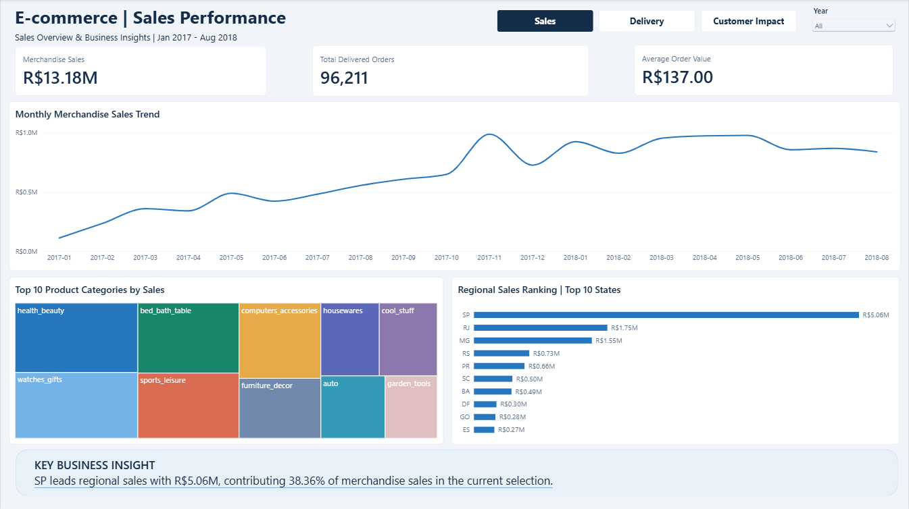
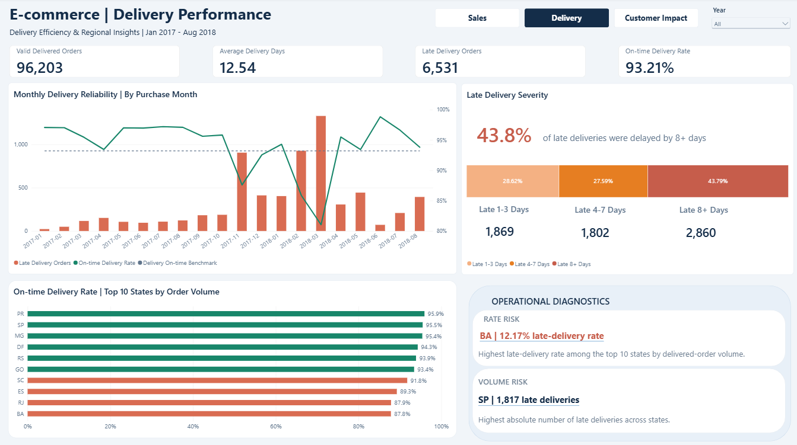
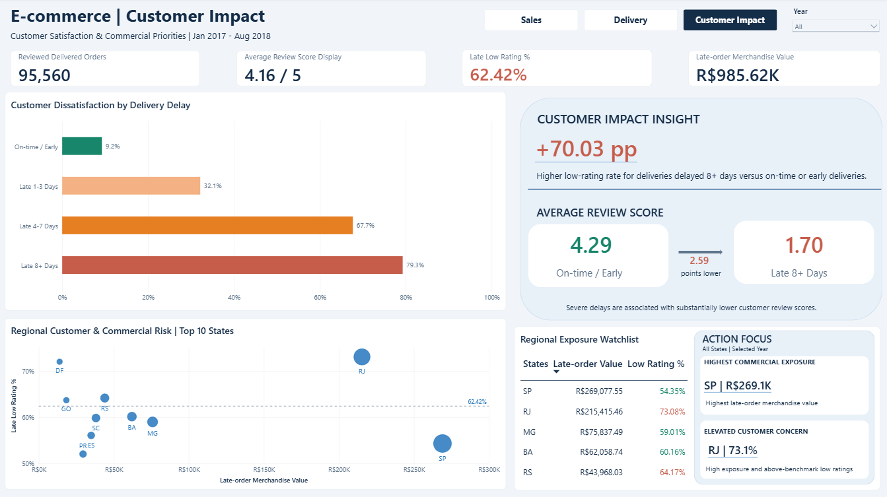

# E-commerce Sales, Delivery & Customer Impact

**SQL (PostgreSQL) | Power BI | Data Validation**  
**Dataset:** [Brazilian E-Commerce Public Dataset by Olist](https://www.kaggle.com/datasets/olistbr/brazilian-ecommerce)  
**Analysis period:** January 2017–August 2018, based on order purchase date

## Overview

This project brings together sales, delivery and customer review data to explore e-commerce performance beyond headline metrics. It looks at where merchandise sales are concentrated, how delivery delays differ across time and regions, and how those delays relate to customer feedback.

The analysis was carried out in PostgreSQL, with the results presented in a three-page Power BI report.

## Business Questions

**Main question**

How can an e-commerce business identify and prioritize delivery improvements based on sales performance, delivery reliability, and customer satisfaction?

**Supporting questions**

1. Where are merchandise sales concentrated across product categories and customer regions?
2. Which regions face the greatest delivery reliability challenges?
3. How much merchandise value is associated with late deliveries, and where is it concentrated?
4. How are delivery delays associated with customer satisfaction?
5. Which regions should be prioritized for operational and customer-experience improvements?

## Tools & Analytical Approach

**Tools:** PostgreSQL, DBeaver, Power BI (Power Query, DAX)

The analysis followed three main stages:

1. **Data preparation & quality checks:** Imported and examined the Olist datasets, checked missing values and duplicate records, validated delivery dates, and created an order-level review view to ensure consistent analysis.

2. **SQL analysis:** Used joins, CTEs, aggregations and window functions to investigate sales performance, delivery reliability, commercial exposure, customer satisfaction and regional priorities.

3. **Power BI & KPI validation:** Built a relational data model and interactive dashboards, developed DAX measures, and reconciled key metrics against SQL results.

Detailed queries are available in the [SQL scripts](sql/), with supporting checks in the [Validation Summary](docs/validation_summary.md).

## Power BI report

| Dashboard | Main Analysis | Business Questions Supported |
|---|---|---|
| **Sales Performance** | Sales trends, product categories and regions | **Q1:** Identify sales concentration and establish commercial importance for prioritization |
| **Delivery Performance** | On-time rates, delay severity and regional diagnostics | **Q2 & Q5:** Identify delivery issues and regions requiring attention |
| **Customer Impact** | Customer reviews and late-order merchandise value | **Q3, Q4 & Q5:** Assess commercial exposure, customer dissatisfaction and improvement priorities |

### Dashboard preview

The report has three connected pages. Screenshots below show the **Year = All** view; select an image to see it at full resolution.

**Sales Performance**  
[](images/01_sales_performance.png)

**Delivery Performance**  
[](images/02_delivery_performance.png)

**Customer Impact**  
[](images/03_customer_impact.png)

## Selected findings

- **R$13.18M** in merchandise sales from delivered orders (excluding freight); **São Paulo (SP)** contributed **38.36%**.
- **93.21%** of valid delivered orders arrived on time or early, but **43.79% of late deliveries** were at least eight days late.
- Low ratings (1–2 stars) appeared in **9.25%** of reviewed on-time/early orders, compared with **79.27%** of reviewed orders delayed by eight or more days.
- Late deliveries were associated with **R$985.62K** in merchandise value. **SP** had the highest amount (**R$269.1K**), while **RJ** combined substantial late-order value (**R$215.4K**) with a **73.08%** low-rating rate among late reviewed orders.

These results point to different priorities: severe delays overall, late-order volume in SP, delivery reliability in Bahia (BA), and customer experience in RJ. Details are in [Business Findings & Recommendations](docs/business_findings_recommendations.md).

## Data checks & KPI scope

The main order populations reconcile between SQL and the Power BI report:

| Population | Orders |
|---|---:|
| Delivered orders with items (sales) | **96,211** |
| Valid delivered orders with usable delivery dates | **96,203** |
| Valid delivered orders with a matching review | **95,560** |

The differences come from **8** orders missing actual delivery timestamps and **643** valid deliveries without a matching review in the deduplicated SQL view. This matters because sales, delivery and review metrics do not share exactly the same denominator.

See the [KPI Dictionary](docs/kpi_dictionary.md) for metric definitions and the [Validation Summary](docs/validation_summary.md) for SQL reconciliation results and remaining checks.

## Repository structure

```text
olist-sales-delivery-analysis/
├── README.md
├── sql/                       # SQL scripts 01–09, including KPI reconciliation
├── powerbi/                   # Power BI report (.pbix)
├── images/                    # Dashboard screenshots
└── docs/
    ├── kpi_dictionary.md
    ├── validation_summary.md
    └── business_findings_recommendations.md
```

## Reproducing the Analysis

1. Download the [Olist dataset](https://www.kaggle.com/datasets/olistbr/brazilian-ecommerce) from Kaggle.
2. Create a PostgreSQL database and run [01_create_tables.sql](sql/01_create_tables.sql) to set up the tables.
3. Import the corresponding CSV files, including product category translations and customer reviews.
4. Run the [SQL analysis scripts](sql/) in order. Script 05 creates the `order_reviews_latest` view used in subsequent analyses.
5. Use [09_kpi_reconciliation.sql](sql/09_kpi_reconciliation.sql) to check the main dashboard metrics.

The [Power BI report](powerbi/Olist_ecommerce_analysis.pbix) can be opened in Power BI Desktop. Refreshing the data may require updating the PostgreSQL connection settings.

## Scope & limitations

The dataset is historical, and 2018 covers January–August only. Review-based measures exclude orders without matching reviews. **Late-order merchandise value is not lost revenue**, and the observed relationship between delivery delays and ratings does not establish causation.

**Source:** Olist's public Brazilian e-commerce dataset on Kaggle. Raw data files are not included in this repository.
